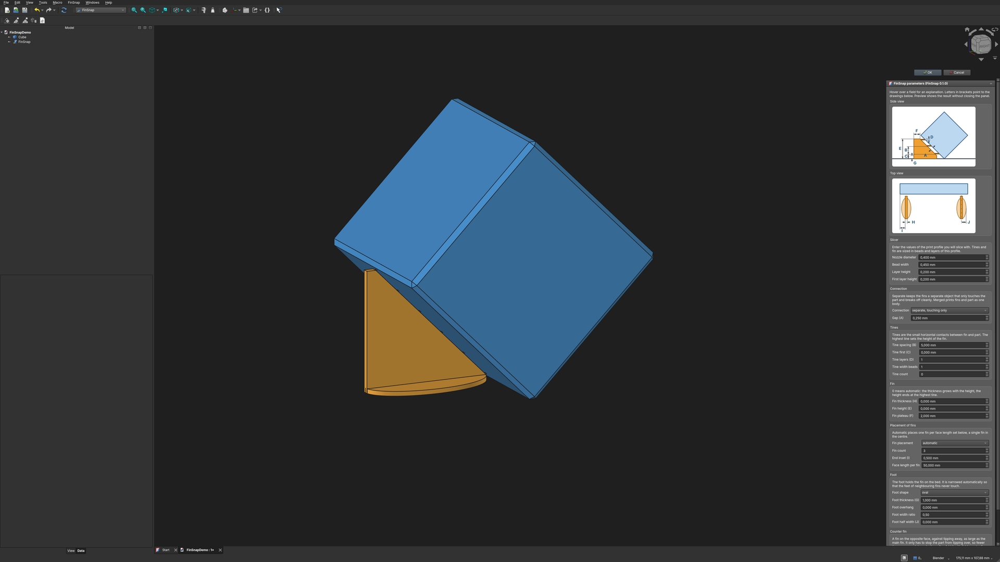
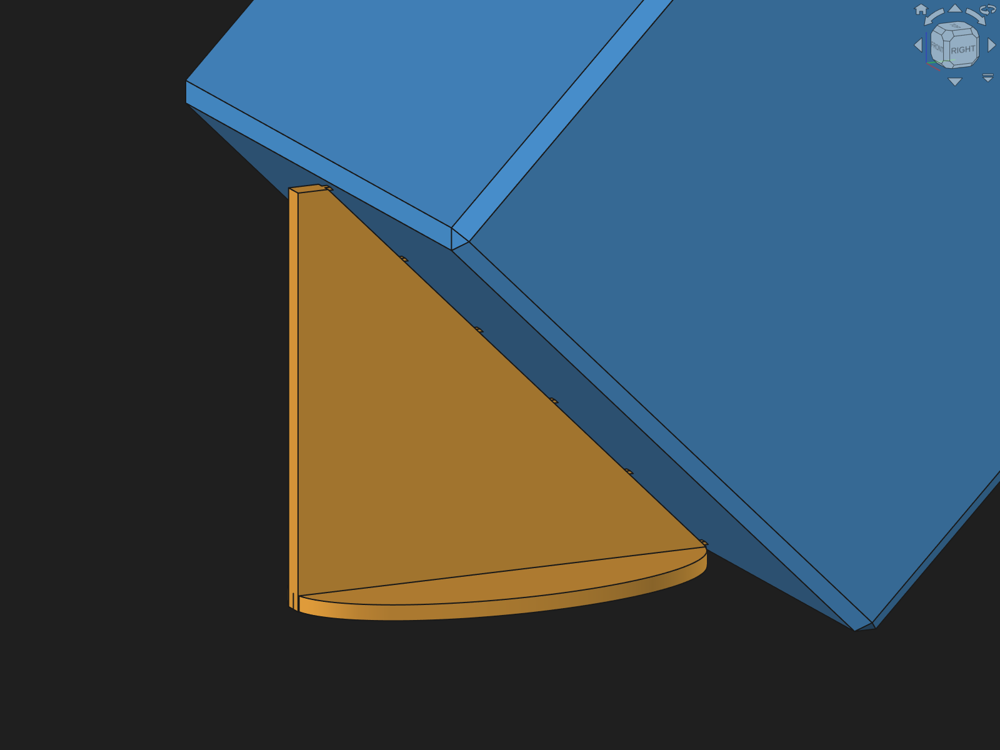

# FinSnap | Breakaway fins for FreeCAD

<p align="center"></p>

[](https://www.gnu.org/licenses/gpl-3.0)
[](https://www.freecad.org/)
[](https://github.com/Maik-0000FF/FinSnap/actions/workflows/ci.yml)
[](https://github.com/sponsors/Maik-0000FF)
[](https://ko-fi.com/maik0000ff)

**A FreeCAD workbench that adds breakaway fins to parts printed standing on an edge.**

Printing a part tilted by 45 degrees puts the layer lines diagonal to the load and gives every side the same surface finish, with no bottom face and no top face. A part standing on an edge has almost no grip on the bed, though. FinSnap adds thin fins next to it that hold it upright. The fins touch the part only with small horizontal tines, so they snap off without leaving marks.



## Why print standing on an edge

A part printed flat is weakest straight across its layers, and two of its faces differ from all the others. Standing on an edge at 45 degrees changes that:

- **Strength:** the layer boundaries run diagonally through the part. A load along one of its main axes no longer pulls a single layer seam apart; it is shared between layers and extrusion paths.
- **Surface:** every side shows the same layer pattern. There is no smooth bottom next to a top skin with a pattern of its own, and no first-layer imprint on a visible face.
- **Accuracy:** no edge rests on the bed, so none is widened by the squashed first layer (elephant's foot).

How much each effect matters depends on the material, the printer and the part.

**Features:**
- Fins generated automatically under a selected face that leans over the bed
- Two connection modes:
  - **separate**: fins are their own object, the tines only touch the part, no extrusion path runs from fin to part
  - **merged**: fins and part become one body, the tines are printed as one path with the part
- Tine height and width in layers and beads, so the design follows the print profile
- Fin height set by the highest tine, thickness grows with the height
- One fin centred, two at the ends, two on the corners, or several distributed along the face
- Oval, rectangular or no foot, narrowed automatically so neighbouring feet never touch
- Counter fin on the opposite face, added with the fins or afterwards; the opposite face is found automatically
- Every automatic value can be overridden by hand
- Works on STEP and FreeCAD bodies; STL meshes are converted to solids first
- 3MF export with every body as its own object, mesh fineness adjustable
- English and German user interface

## How it works

The fin's inner edge runs parallel to the supported face at a set gap. Horizontal tines bridge the gap and end exactly on the face. In the separate mode the slicer prints the fin and the part as two objects: the tine lies against the part and sticks to it, without an extrusion path crossing over.



## Installation

### Addon Manager

FinSnap is not yet listed in the FreeCAD Addon Manager. Until then, install it manually.

### Manual

Clone the repository into the `Mod` folder of your FreeCAD user data directory and restart FreeCAD:

```bash
git clone https://github.com/Maik-0000FF/FinSnap.git ~/.local/share/FreeCAD/Mod/FinSnap
```

The folder differs by system and version; FreeCAD shows it under **Tools → Addon manager → Settings** and in the Python console with `App.getUserAppDataDir()`.

## Commands

The workbench adds one toolbar and a **FinSnap** menu with these commands, in the order they are usually used:

| | Command | What it does | How to use it |
|---|---|---|---|
|  | **Stand on edge** | Lays one face of the part onto the bed, turns the part about an edge of that face by the tilt angle and sets it back onto the bed, standing on that edge. Inside a Body, the whole Body is turned. | Select the edge and the face of that edge that is to lie on the bed, click the button and enter the angle (45 degrees by default). For an edge already on the bed, the edge alone is enough. A chamfer or a fillet selected alone is laid onto the bed and carries the part, without asking for an angle. Two faces selected alone, such as the two beside a fillet, stand the part on what joins them, both equally steep. |
|  | **Lay flat again** | Puts a part stood on an edge back as it lay before. Deleting the last fins of a part does the same. | Select the part or its fins and click the button. |
|  | **Add fins** | Creates the fins under a face that leans over the bed and opens the task panel with automatic values. | Select the leaning face, click the button, adjust the values in the panel, which shows every change right away, and click **OK** to keep them. Select a second face on the opposite side as well to get a counter fin straight away. Double-click the fins in the tree to open the panel again. |
|  | **Add counter fin** | Adds a fin on the opposite side of existing fins, against tipping away, as large as the main fin. Fewer counter tines in the panel make it smaller. | Select the fins and click the button: the face leaning the other way is found automatically. To choose it yourself, select a face of the part as well. To remove the counter fin, clear its face in the property view. |
|  | **Mesh to solid** | Turns an imported STL mesh into a solid with planar faces, so fins can be added to it. | Import the STL, select the mesh object and click the button. The mesh is hidden, the solid appears next to it. |
|  | **Export 3MF** | Writes a 3MF file for the slicer, every body as its own object, see [What the 3MF file contains](#what-the-3mf-file-contains). | Click the button with nothing selected to export all fins with their parts, or select what to export. Selecting the fins alone brings their part along. Set the mesh fineness, then choose the file. |

Every button shows a tooltip with these explanations when the pointer rests on it.

## Usage

1. Stand the part on an edge: select an edge of the part and the face of that edge that is to lie on the bed, then click **Stand on edge** (45 degrees by default). A part with a chamfered or rounded edge stands on it: select the chamfer or fillet alone, or the two faces beside it. Or orient the part yourself.
2. Switch to the **FinSnap** workbench.
3. Select the face that leans over the bed.
4. Click **Add fins**. The task panel opens with automatic values.
5. Enter the slicer settings of your print profile: nozzle diameter, bead width, layer height, first layer height.
6. Adjust any value and confirm with **OK**. Every change shows in the 3D view right away. Fields that have no effect with the current choices are greyed out, and their tooltip says why. A field that differs from the standard for new fins is marked in orange, and the button beside it puts the standard back. **Save as standard** makes the current values the start of every new fin; **Factory settings** goes back to the built-in values. The letters next to the fields point to the side view and top view drawn in the panel.
7. Check the overhangs: faces that lie flatter than 45 degrees over the bed and carry no fins are marked red and listed under the warnings of the fins. Add fins or a counter fin there, or plan support in the slicer. Stand on edge already selects such faces after the tilt.
8. For a counter fin against tipping away, select the fins and click **Add counter fin**. The face leaning the other way is found automatically; select a face of the part as well to choose it yourself.
9. Click **Export 3MF**. With nothing selected, all fins of the document are exported together with their parts; otherwise the selection is exported. Selecting the fins alone also brings their part along.

An STL file is imported first, then turned into a solid with **Mesh to solid**. Fins can be added to its planar faces.

## Slicing

> [!IMPORTANT]
> When the 3MF file is opened, PrusaSlicer asks:
>
> **Multi-part object detected**
> *"This file contains several objects positioned at multiple heights. Instead of considering them as multiple objects, should the file be loaded as a single object having multiple parts?"*
>
> Answer **No**. With **Yes**, part and fins become parts of one object, and the slicer joins them with a continuous path, which is exactly what the separate mode avoids.

- Keep supports off; the fins are the support.
- The tine height should be a whole number of layers of the print profile, otherwise a tine falls between two layers.
- A gap that makes the tines shorter than about three quarters of a bead leaves them short of the face. FinSnap warns about this.
- In the merged mode, set the seam position of the print profile to rear or random. Otherwise the slicer tends to place the seam where the tines join the part, which shows as a vertical line along the tines.

## What the 3MF file contains

**Export 3MF** writes a plain 3MF file (core specification, no slicer project):

- **One object per body**, named after it: the part as `<part>`, its fins as `<part>_fins`. In the merged mode, part and fins are one object.
- **Triangle meshes in millimetres.** Planar faces are exact; curved surfaces follow the mesh fineness chosen in the export dialog (surface deviation, default 0.01 mm, and angular deviation, default 1 degree).
- **Metadata** `Application` with the name and version that wrote the file, `FinSnap <version>`, and `CreationDate` with the date of the export.
- **No print settings, supports or colours.** The slicer opens the file with its own print profile.

The file is a ZIP archive; the content above sits in `3D/3dmodel.model`. A slicer that saves the file again as its own project may replace the metadata with its own.

## Parameters

| Group | Parameter | Automatic | Meaning |
|---|---|---|---|
| Slicer | Nozzle diameter, bead width, layer height, first layer height | | Values of the print profile |
| Connection | Connection | separate | separate or merged |
| | Gap | 0.25 mm | Clearance between fin and face, along the face normal |
| Tines | Tine spacing | 5 mm | Vertical distance between tines |
| | Tine first | 0 = on the top of the foot | Height of the lowest tine |
| | Tine layers | 1 | Tine height in layers |
| | Tine width beads | 1 | Tine width in beads |
| | Tine count | 0 = as many as fit | Tines per fin |
| Fin | Fin thickness | 0 = from height, at least 3 beads | Wall thickness |
| | Fin height | 0 = top of the highest tine | Height of the fin. A lower value leaves out the tines above it; at most just below the top of the face |
| | Top width | 2 mm | Width of the flat top of the fin, instead of a tip |
| Placement | Fin placement | auto | auto, centre, ends, corners, distributed. Corners puts a fin on each end of the face: each tine lies whole on the face and ends flush with its end, so the tine marks merge with the edges. The fin itself reaches a little past the end |
| | Fin count | 3 | Fins for distributed placement |
| | End inset | 0.5 mm | Distance of the outer fins from the face ends |
| | Face length per fin | 50 mm | Automatic placement adds one fin per this length |
| Foot | Foot shape | oval | oval, rectangle, none |
| | Foot thickness | 1 mm | Rounded to whole layers |
| | Foot overhang | 0 mm | Reach past the straight outer end of the fin |
| | Foot width ratio | 0.5 | Foot width as a share of its length |
| | Foot half width | 0 = from ratio | Half width of the foot |
| Counter fin | Counter tine count | 0 = as many as the main fin | Tines of the counter fin; it only has to stop the part from tipping over, so it may be smaller |

## Requirements

- FreeCAD 1.1 or newer, tested with the stable release and the weekly builds

## Development

The tests run in FreeCAD's console:

```bash
freecad --console tests/test_cube.py
freecad --console tests/test_feature.py
QT_QPA_PLATFORM=offscreen freecad tests/test_gui.py
python3 tests/test_version.py
```

The CI checks every push: lint with ruff, complete translations, and the tests against the stable FreeCAD release.

`tools/check_gcode.py` checks a sliced G-code file: no path may run from a fin into its part, and every tine has to reach the part.

## Contributing

Bug reports and ideas are welcome as [issues](https://github.com/Maik-0000FF/FinSnap/issues). See the [Contributing guide](CONTRIBUTING.md) for translations and code changes.

## Support

> If you find FinSnap useful, you can support its development:
>
> <a href="https://github.com/sponsors/Maik-0000FF">
>   
> </a>
> &nbsp;
> <a href="https://ko-fi.com/maik0000ff">
>   
> </a>
>
> A star also helps, it makes this project easier to discover.

## License

GPL-3.0-or-later

## Author

Created by [Maik-0000FF](https://github.com/Maik-0000FF)
